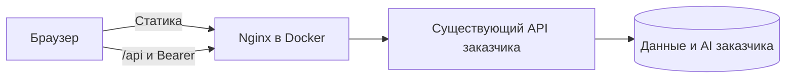

# System design

Актуализировано 6 октября 2026 года: студент и административный аналитический дашборд по 12 операциям Swagger.

## Границы системы



Один фронтенд, один контейнер. API остаётся внешним. Vite в разработке и Nginx в контейнере удаляют префикс /api перед проксированием. API_UPSTREAM задаётся при запуске; секреты AI клиент не получает.

## Стек

| Слой | Выбор |
| --- | --- |
| Приложение | React SPA, TypeScript, Vite |
| Интерфейс | Mantine, Tabler Icons |
| Аналитика | Recharts, собственные сетки тепловых карт, Plotly GL3D для поверхностей |
| Маршруты | React Router |
| Серверные данные | TanStack Query, fetch |
| Контракт | openapi-typescript, сохранённый OpenAPI |
| Поставка | Node 24 для сборки, Nginx для запуска |

SPA подходит для кабинетов за входом, без публичного поискового содержимого. SSR и отдельный сервер приложению сейчас не нужны. Аналитический дашборд использует Recharts для диаграмм, Mantine для контролов и таблиц, CSS-сетки для тепловых карт. Дашборд и библиотека диаграмм загружаются отдельным модулем при входе в административный раздел. Преобразования агрегатов находятся в features/admin/analytics.ts; дополнительных запросов, базы или сервера для графиков нет.

Вкладка 3D отдельно загружает `ThreeDCharts` и Plotly GL3D (локальный пакет, без CDN). `surface-data.ts` строит календарную сетку и гистограмму освоения/охвата; `SurfacePlot.tsx` управляет камерой, WebGL, жестами и полным экраном. Рельефы используют ту же сводку API, дополнительные запросы не нужны. При уходе со вкладки сцены очищаются; при недоступном WebGL доступны исходные данные и обычные графики. Большой GL3D chunk (~1.69 MB, ~538 KB gzip) загружается только по открытию 3D.

## Структура

```text
compose.yaml
.env.example
project-plan/
  contracts/
web/
  src/
    app/               # провайдеры, маршруты и проверки роли
    api/               # транспорт, типы, ошибки, токен и dev-моки
    features/auth/     # вход, регистрация, профиль и серия
    features/chat/     # диалог, задание, оценка и состояние вкладки
    features/skills/   # навыки, прогресс и слабые места
    features/admin/    # дашборд
    shared/ui/
  Dockerfile
  nginx.conf.template
```

## Сценарии

1. Вход получает JWT и профиль. Токен хранится в sessionStorage; /me восстанавливает и обновляет профиль. Защищённый 401 очищает токен/кеш и открывает вход; 403 показывает отказ без завершения сеанса. Неверный вход объясняется отдельно.
2. Публичная форма регистрации явно передаёт role=student, требует группу. Доверие к назначению роли проверяет сервер. admin попадает на /dashboard, student — на /chat, остальные — на /profile. Маршруты и навигация проверяют роль; это дополняет серверную авторизацию.
3. /chat/history загружает последние 50 записей. Реальный сервер пока ставит AI-ответ перед вопросом. Только при полном наборе валидных времён одного формата сортируем по времени; null и смешение времён с/без зоны не исправляем догадками. question_id помечает связь с заданием; поля kind больше нет.
4. /task вызывается вручную без автоматического повтора. При текущем задании требуется подтверждение. На время отправки ответа запуск другого задания отключён. Ответ передаёт question_id либо null для свободного диалога.
5. Если /chat вернул task_completed=true **или** assessment != null, сбрасываем активное задание и переключатель, показываем level/feedback, обновляем прогресс, серию и профиль. Шкалу level не выдумываем.
6. Сервер пока неверно восстанавливает задание: меняет текст на последнюю реплику и не очищает завершённый ID. В sessionStorage по user.id сохраняем исходный выданный клиентом текст и до 20 подтверждённых завершённых ID. Это защищает текущую вкладку после перезагрузки; новая вкладка/устройство требует исправления API. Структурированную оценку после новой сессии перечитать нельзя.
7. /skills и /progress связываются по skill_id. Отображаем прогресс 0–100, weaknesses и пустые состояния. /streak обновляет серию в профиле.
8. /administration/stats?days получает данные для admin. Период 7/30/90/365 дней влияет только на daily_activity по контракту; остальные агрегаты не переименовываем в показатели периода. Выводим все семь полей, пустые состояния, ошибки и ручное обновление. Большие таблицы прокручиваются на телефоне.

Мутации не повторяются автоматически. Ошибка POST не доказывает, что запись отсутствует на сервере; UI предлагает сверить историю/текущее задание. Dev-моки доступны только в режиме разработки; production-сборка их исключает.

## Развёртывание и приёмка

Адрес из текущего Swagger — HTTP. Он используется для разрешённой тестовой проверки. Для публичного выпуска нужны HTTPS на фронтенде и upstream, закрытое назначение повышенных ролей, корректные /task/current и порядок истории. JWT не пишется в URL или логи клиента, тексты AI выводятся как текст, Nginx задаёт CSP.

Проверка состоит из типизации/сборки, тестов ключевых переходов и запросов к серверу через Docker-прокси. Тестовые данные доступа хранятся только в игнорируемой .local; они не включаются в образ. Результаты и ограничения — в implementation-status.md и integration-2026-10-05.md.

## Поставка заказчику

Обязательная конфигурация — один корневой `.env` из `.env.example`: `API_UPSTREAM` и `WEB_PORT`. Запуск — `docker compose up -d --build`. Compose требует непустой URL API; entrypoint проверяет схему и нормализует завершающий слеш до генерации Nginx-конфига. Адрес API применяется при запуске контейнера и не вшит в bundle. `web/.env.local` относится только к разработке и исключён из образа.

В Compose настроены `restart: unless-stopped`, healthcheck `/healthz`, ротация логов и имя `host.docker.internal` для API на хосте. Healthcheck проверяет только Nginx/фронтенд, а не внешний API. HTML отдаётся без кеширования, хешированные assets кешируются; отсутствующий asset возвращает 404. Инструкция для заказчика — [DEPLOYMENT.md](../DEPLOYMENT.md).

`scripts/deployment-review.mjs` создаёт чистую копию передаваемых файлов по списку Git, проверяет отсутствие локальных env/QA-паролей, собирает отдельный Docker Compose проект, проверяет маршруты, healthcheck, реальный GET /groups, заголовки и изменение `.env` без пересборки. Тестовый контейнер после проверки удаляется, основной контейнер не затрагивается. Серверные исправления по просьбе пользователя временно отложены; проверка поставки не считается их исправлением.
